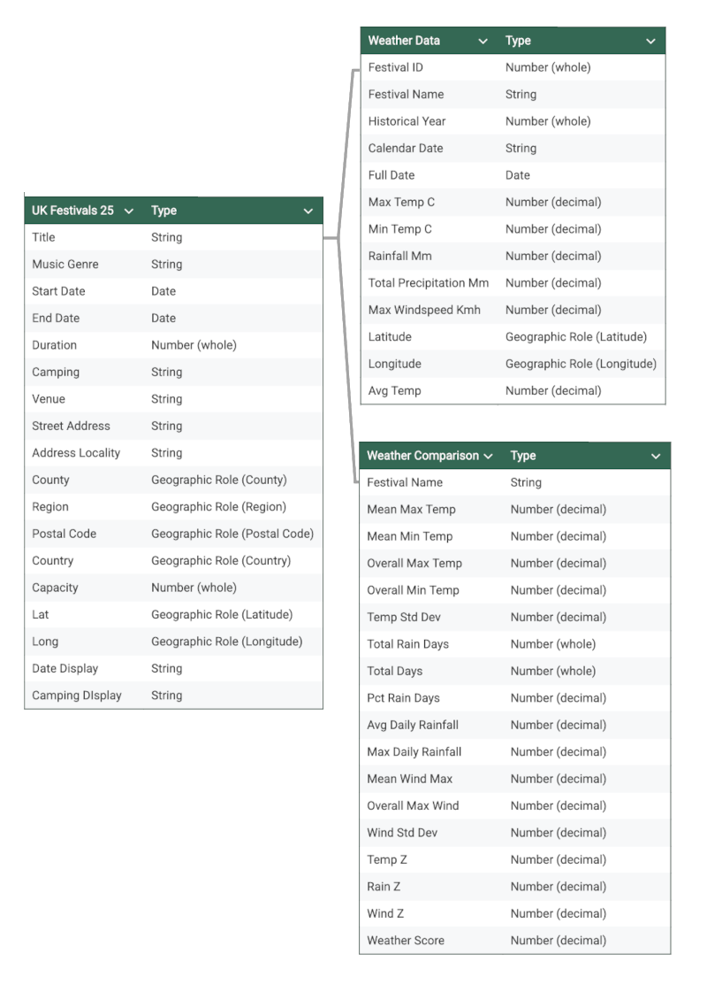
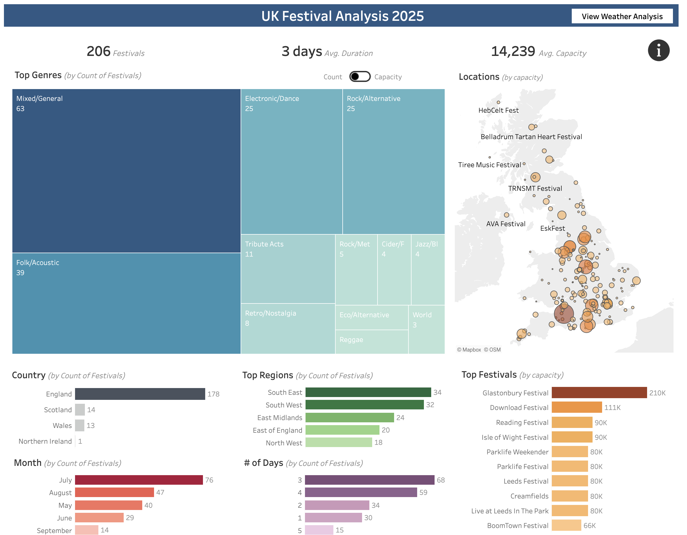
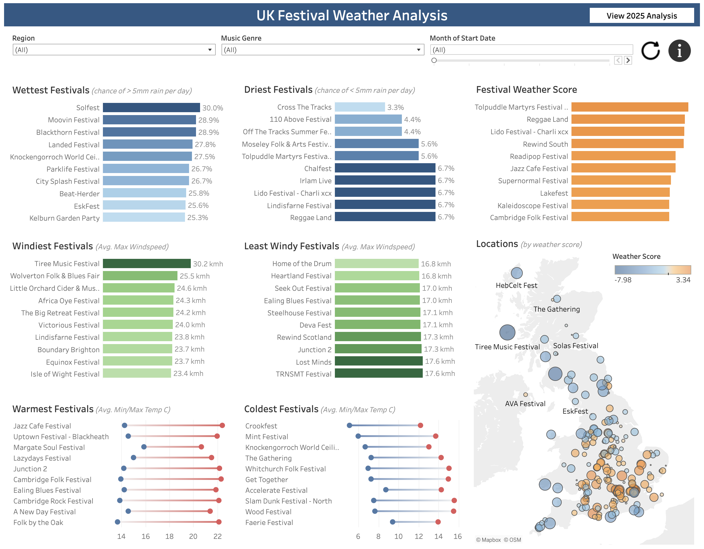

# UK Festival Analysis
Which UK festivals have the best weather? I scraped details of 206 UK festivals for 2025, then cleaned and geocoded them. For each festival, I pulled weather for the same dates in every year from 1995 to 2024 using the Open-Meteo API. I combined temperature, rain days (over 5mm) and wind into a Festival Weather Score using z-scores, and built Tableau dashboards to compare festivals by region, genre and month.

## Overview

- Festival info scraped from the internet, extracted, cleaned, augmented, geocoded
- Geocoded weather data sourced from Open-Meteo.com
- Screaming Frog, Google Sheets, Geocoding by SmartMonkey, Claude.ai, R, Python & Tableau used
- Data imported into Tableau and augmented with calculated fields to support further analysis

## Data Structure

The database structure as seen below consists of 3 tables, 'UK Festivals', 'Weather Data' and 'Weather Comparison':

The steps taken to process the data prior to analysis in Tableau can be found [here](documentation/data-prep-summary.md).

## Methodology

- Web scraping and data collection
- Data cleaning and transformation
- API integration
- Statistical analysis
- Geographic data processing
- Data visualisation in Tableau

## Tools Used

- Data Collection: Screaming Frog
- Data Processing: Google Sheets, Python (pandas, NumPy, SciPy)
- API Integration: Open-Meteo API
- Development: RStudio
- Visualization: Tableau

## Dashboard Structure

### 1. Festival Market Overview Dashboard

#### Key Metrics (BANs)

- **Total festivals** (206)
- **Average duration** (3 days)
- **Average capacity** (14,239)

#### Market Segmentation Visualizations

- **Top Genres** treemap showing distribution by count/capacity
- **UK Map** showing geographic distribution of festivals with size/color indicating capacity
- **Country breakdown** bar chart by count/capacity
- **Top Regions** bar chart by count/capacity
- **Month distribution** bar chart by count/capacity
- **Duration distribution** bar chart by count/capacity
- **Top Festivals** by capacity bar chart

### 2. Weather Analysis Dashboard

#### Filter Controls
- **Region dropdown** for geographic filtering
- **Music Genre dropdown** for genre-specific analysis
- **Search by Festival Name text field** for festival-specific analysis
- **Month slider** for temporal filtering

#### Weather Metric Comparisons
- **Wettest Festivals** bar chart showing rainfall probability
- **Driest Festivals** bar chart showing minimal rainfall chance
- **Windiest Festivals** bar chart showing average max windspeed
- **Least Windy Festivals** bar chart

#### Temperature Analysis
- **Warmest Festivals** dot plot showing min/max temperature ranges
- **Coldest Festivals** dot plot showing min/max temperature ranges

#### Summary Metrics
- **Festival Weather Score** bar chart ranking overall weather quality
- **Weather Map** showing geographic distribution of festivals with color-coded weather scores

## Key Findings

- Market Analysis:
  - Mixed/general is the leading genre with 63 festivals (1.3 million capacity)
  - July hosts the most festivals (76), but August has the highest capacity (885k)
  - South East England leads with 34 festivals (580k capacity)
  - Typical festival duration is 3 days

- Weather Analysis:
  - Driest: Cross the Tracks (3.3% chance of significant rainfall)
  - Least Windy: Home of the Drum (16.8 km/h avg. max wind)
  - Warmest: Jazz Cafe Festival (14.3–22.4°C)
  - Best Overall Weather: Tolpuddle Martyrs Festival and Rally

## How to view the dashboard

*Dashboard 1: UK Festival Market Analysis 2025*

*Dashboard 2: Historical Weather Analysis by Festival Location*

[View Interactive Dashboards on Tableau Public ↗](https://public.tableau.com/app/profile/dom.barry/viz/UKFestivalAnalysis2025/FestivalAnalysis)

## Caveats & Assumptions

Festival-specific information was scraped from third-party sites and is not guaranteed to be reliable, but it does provide a reasonable data set for analysis. It would be very interesting to repeat this analysis using first party data from industry bodies and/or licensing authorities.